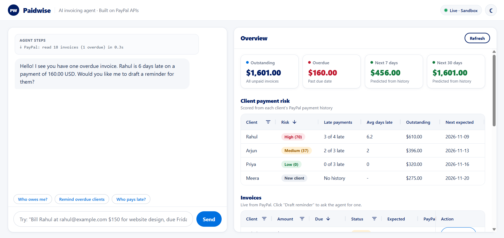
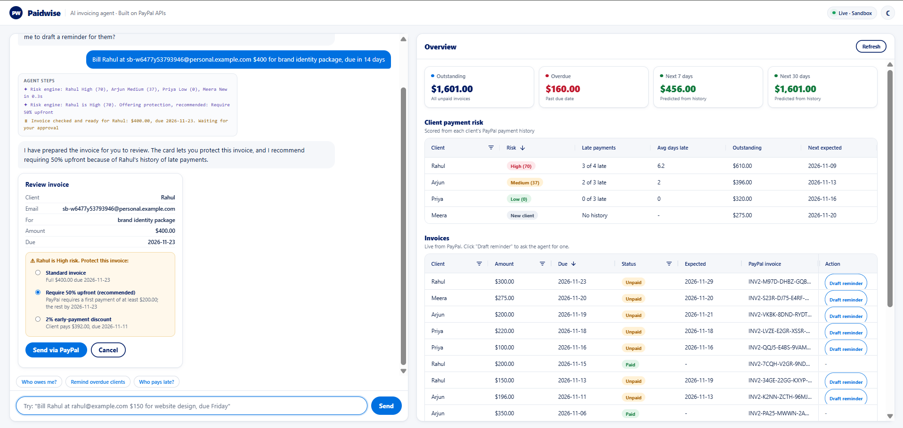
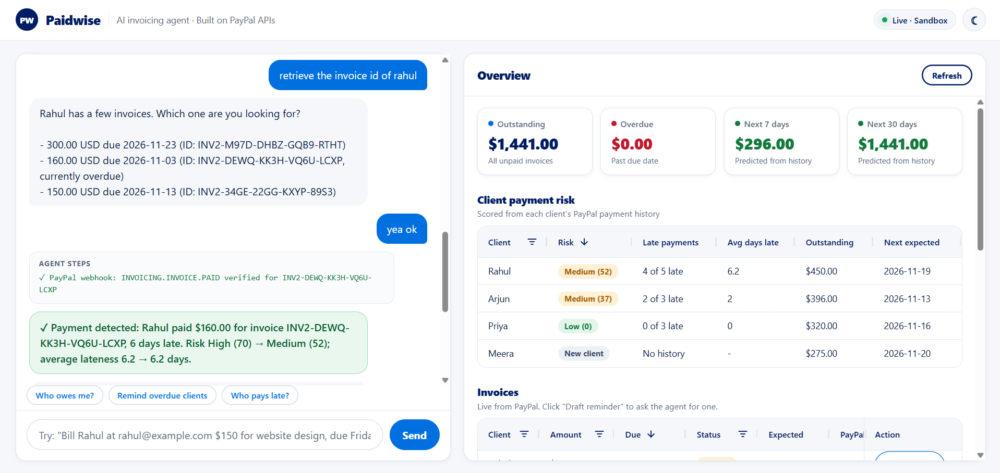
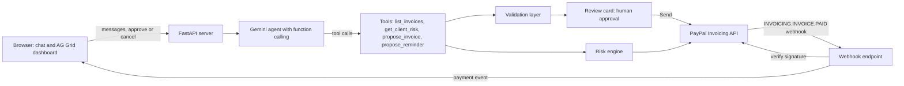

# Paidwise

**An AI invoicing agent that turns plain-English requests into PayPal invoices, learns which clients pay late, and chases them the right way.**

Built for the *Build What's Next with PayPal and AI* hackathon.

- **Live demo:** https://paynudge-zepy.onrender.com
- **Demo video:** _add YouTube link here_

> The demo runs on Render's free tier. If it has been idle, the first load can take 30-60 seconds while it wakes up.

---

## The problem

Freelancers and small sellers spend a lot of time and stress chasing unpaid invoices. Normal invoicing tools are passive: you fill in a form, they send it, and then it is on you to notice who has not paid, decide when to follow up, and work out what to say.

This hits **Indian freelancers billing international clients** especially hard. They often agree on work informally, invoice overseas clients through PayPal, and lose time and cash flow when payments run late.

## What Paidwise does

Paidwise is an AI agent connected to the PayPal Invoicing API. It does not just send invoices; it helps you **get paid**.

- **Invoice by chatting.** Type "Bill Rahul at rahul@example.com $150 for website design, due Friday". The agent extracts the details and prepares a real PayPal invoice.
- **Human approval for every money action.** Nothing is sent until you click **Send via PayPal** on a review card.
- **Late-payment risk scoring.** Each client gets a Low / Medium / High / New score from their real PayPal payment history, with a plain-English reason.
- **Risk-aware behaviour.** Reminders to high-risk clients are firmer; reminders to reliable clients are gentle. Billing a risky client triggers a warning.
- **Invoice protection for risky clients.** The review card offers **Require 50% upfront** (enforced by PayPal's partial-payment setting) or a **2% early-payment discount** with a short due date. The best option is pre-selected from the risk score.
- **Proactive nudge.** When the app opens, the agent checks PayPal on its own and tells you who is overdue.
- **Live payment alerts.** When a client pays, a verified PayPal webhook updates the dashboard instantly and shows the client's real before-and-after risk.
- **Cash-flow forecast.** Predicts how much money is likely to arrive in the next 7 and 30 days, using each client's typical delay.
- **Visible agent steps.** Every reply shows exactly which tools ran and what PayPal returned.
- **AG Grid dashboard.** Sortable, filterable grids for client risk and invoices, with a "Draft reminder" button on each unpaid invoice.
- Optional dark mode.

## Screenshots







## Architecture



**Flow:** the browser sends a message to the FastAPI server. Gemini decides which tool to call. Read tools (`list_invoices`, `get_client_risk`) query PayPal directly. Write tools (`propose_invoice`, `propose_reminder`) never touch money: they pass the AI's values through a validation layer and create a review card. Only when the user clicks **Send** does the server call PayPal. When a client pays, PayPal sends a webhook, the server verifies it with PayPal, re-scores the client, and the open page shows the alert.

## PayPal APIs used

| PayPal API | What Paidwise uses it for |
|---|---|
| `POST /v1/oauth2/token` | Authenticates the app (token is cached until it expires) |
| `POST /v2/invoicing/invoices` | Creates invoices, including partial-payment minimums and invoice discounts |
| `POST /v2/invoicing/invoices/{id}/send` | Sends invoices to clients and returns the payment link |
| `GET /v2/invoicing/invoices` | Lists invoices with status and due dates |
| `GET /v2/invoicing/invoices/{id}` | Reads payment dates for the risk engine |
| `POST /v2/invoicing/invoices/{id}/remind` | Sends AI-written payment reminders |
| `POST /v2/invoicing/invoices/{id}/payments` | Records past payments, used only by the demo data script |
| Webhooks: `INVOICING.INVOICE.PAID` | Real-time payment detection |
| `POST /v1/notifications/verify-webhook-signature` | Confirms each webhook really came from PayPal; fake ones are rejected |

## How AI is used

- **Model:** Google Gemini via the `google-genai` Python SDK. Main model `gemini-3.1-flash-lite`, backup model `gemini-2.5-flash`.
- **Function calling:** Gemini gets four typed tools (from Python type hints and docstrings) and decides which to call. It never calls PayPal write actions directly.
- **Human in the loop:** invoices and reminders are only *proposed* by the AI. The user approves every money action with a button.
- **Validation in code:** before any review card appears, the server checks the AI's values: a valid email, an amount between $0.01 and $10,000, and a due date in the correct format that is not in the past. A reminder is only allowed for an invoice ID that really exists in PayPal and is still unpaid, so the AI cannot invent invoice IDs.
- **Grounding:** the agent answers from live PayPal data and risk scores returned by tools, and is instructed never to make up IDs, statuses, or scores.
- **Writing:** Gemini writes reminder messages, adjusting tone to the client's risk level.
- **Resilience:** if Gemini is overloaded, the server retries, then switches to the backup model while keeping the conversation history.

## How the risk score works

The score is a simple, explainable weighted score, not a trained model. With only a handful of invoices per client, a trained model would mostly be guessing; a transparent score is more honest and easy to check.

For each client, based on their **paid** invoices:

- `late_ratio` = share of invoices paid after the due date
- `avg_days_late` = average days late (paying early counts as 0)
- `overdue_now` = whether they currently have an overdue invoice

```
score = 50 x late_ratio + 30 x min(avg_days_late, 15) / 15 + (20 if overdue_now)
```

- **High:** 60 or more. **Medium:** 30 to 59. **Low:** below 30.
- **New:** no paid invoices and nothing overdue.
- **Expected payment date** for an open invoice = due date + the client's average delay.

Example from the demo: Arjun was **Medium (48)** while he had an overdue invoice. After he paid it 3 days late, his late count went up, but the "currently overdue" part no longer applied, so his score became **Medium (37)**. The webhook alert shows this before-and-after change with the real numbers.

With more real payment history, this score could be replaced by a trained model using the same inputs.

## Run it yourself

**Requirements:** Python 3.12, a PayPal Developer account, and a Gemini API key.

1. **Clone and install**

   ```
   git clone https://github.com/bhavyaanil07/invoice-assistant.git
   cd invoice-assistant
   pip install -r requirements.txt
   ```

2. **PayPal sandbox setup** (developer.paypal.com, Sandbox mode)
   - Create an app under **Apps & Credentials** and copy the Client ID and Secret.
   - Under **Testing Tools -> Sandbox Accounts**, create a **Personal** account in a country **outside India** (for example the United States). See the note below.

3. **Configure:** copy `.env.example` to `.env` and fill in your values.

4. **Load demo data (once):**

   ```
   python seed_demo.py
   ```

   This creates 12 sandbox invoices for four personas (Rahul, Priya, Arjun, Meera) with past payment history, so the risk scores show Low, Medium, High and New.

5. **Start the app:**

   ```
   python -m uvicorn server:app --reload
   ```

   Open http://127.0.0.1:8000

**Webhooks** need a public URL, so they only work when deployed (for example on Render). Add a webhook in your PayPal app pointing to `https://YOUR-APP/api/paypal/webhook` with the event **Invoicing invoice paid**, then set `PAYPAL_WEBHOOK_ID`.

**Deploying on Render:** build command `pip install -r requirements.txt`, start command `uvicorn server:app --host 0.0.0.0 --port $PORT`, and add the values from `.env.example` as environment variables.

### Note on India-based sandbox accounts

PayPal India blocks invoices sent to customers within India (`INR_FOREIGN_CURRENCY_BLOCKED`). Invoices to customers outside India work normally. This is also why Paidwise focuses on freelancers billing international clients. If your developer account is Indian, use a sandbox buyer account from another country, and use USD.

## Project structure

| File | Purpose |
|---|---|
| `server.py` | FastAPI server: Gemini agent, tools, validation, approval flow, webhook endpoint |
| `paypal_client.py` | PayPal calls: auth, create/send/list invoices, reminders, deposits and discounts |
| `risk.py` | Risk scoring and expected payment dates |
| `webhooks.py` | Webhook signature verification and invoice lookup |
| `static/index.html` | Chat UI, review cards, AG Grid dashboard, payment alerts, dark mode |
| `seed_demo.py` | Creates the demo personas and payment history |
| `paypal_test.py` | Quick check that PayPal credentials work |

## Limitations (honest notes)

- **Sandbox demo data.** Client histories are created by `seed_demo.py` using PayPal's record-payment API. They are not real customers.
- **Early-payment discount is not conditional.** PayPal applies the discount whenever the client pays; the short due date is what encourages fast payment. The 50% upfront option is enforced by PayPal.
- **In-memory state.** Chat sessions and payment alerts are kept in memory and reset when the server restarts.
- **Shared demo account.** Everyone using the hosted demo shares one sandbox account.
- **Simple risk score.** It is transparent by design; a trained model would need more history.
- **AI wording varies** slightly between runs; the demo data is reproducible, the exact sentences are not.

## Tools used

- **Google Gemini** (`gemini-3.1-flash-lite`, `gemini-2.5-flash`) via `google-genai`: the agent's reasoning, tool selection and reminder writing
- **PayPal REST APIs** (sandbox): Invoicing v2, OAuth, Webhooks
- **FastAPI**, **Uvicorn**, **Requests**, **python-dotenv**: backend
- **AG Grid Community**: client risk and invoice grids
- **Render**: hosting
- An AI coding assistant was used to help write and debug the code.

## License

MIT, see [LICENSE](LICENSE). Built by Bhavya Anil.
